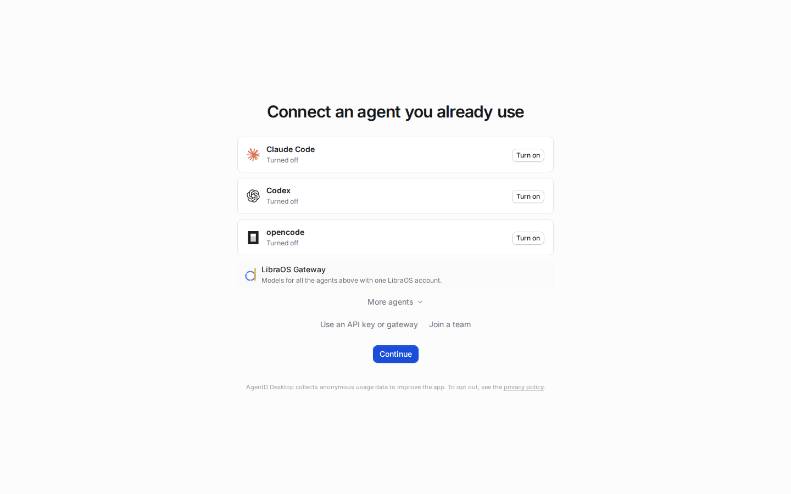
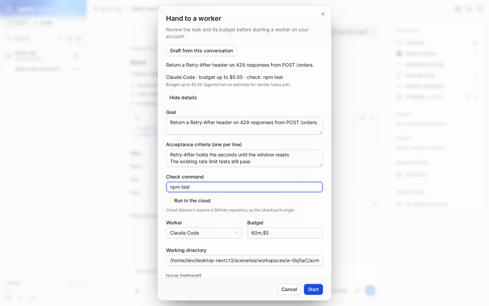

# AgentD Next

AgentD Next is an IDE for working with coding agents. You chat with an agent, work on a project with it, and hand tasks to workers that [agentd](https://github.com/libraos/agentd-core) runs, each with a goal, acceptance criteria, a check and a budget.

It uses the agents already installed and signed in on your machine, such as Claude Code, Codex and opencode. It has no model access of its own and favours no agent. agentd is the authority on tasks, approvals and workers: the app shows them and keeps no copy of its own as the truth.

It runs on macOS, Linux and Windows.


## What you can do

- **Connect the agents you already use.** The first run lists Claude Code, Codex and opencode, with more under **More agents**. **LibraOS Gateway** gives every agent models through one LibraOS account, and **Join a team** enrolls this device with a team's agentd server. Settings → Providers changes any of it later.
- **Chat or Code.** Chat is a conversation with an agent. Code is a project: its files, branch and changes sit beside the conversation.
- **Hand a task to a worker.** From a session, or from a task card the chat drafts, start an agentd worker with a goal, acceptance criteria, a check command and a budget. The budget comes from agentd's estimate for similar tasks. **Run in the cloud** sends it to Cloud Workers instead of this machine.
- **Follow the work.** The session panel lists the project's background tasks, running and finished, with live output and Stop, and every AgentD worker running now, on this machine, a team node or in the cloud.
- **Review the result.** A finished Cloud Workers task opens its changes in a review dialog with the diff viewer.
- **See agentd's state.** The AgentD page shows agentd's status and checks, what needs you (approvals and messages), and the workers and team nodes.
- **Set agentd up from the app.** When agentd is not set up yet, the app shows its End User Agreement and runs the setup when you accept. Chat and Code work without it.

| First run                                                            | Hand to a worker                                                                            |
| -------------------------------------------------------------------- | ------------------------------------------------------------------------------------------- |
|  |  |

## Install

Installers are on the [releases page](https://github.com/libraos/agentd-desktop-next/releases), with agentd and its Skills inside. The files and the app still carry the earlier name, AgentD Desktop.

| System                | File                          |
| --------------------- | ----------------------------- |
| macOS (Apple silicon) | `AgentD-Desktop-…-arm64.dmg`  |
| macOS (Intel)         | `AgentD-Desktop-…-x64.dmg`    |
| Windows               | `AgentD-Desktop-…-x64.exe`    |
| Linux                 | `….AppImage` or `…-amd64.deb` |

The builds are not signed yet:

- **macOS:** the first time, right-click the app in Applications and choose **Open**. If it still will not open, run `xattr -dr com.apple.quarantine "/Applications/AgentD Desktop.app"`.
- **Windows:** SmartScreen asks once. Choose **More info**, then **Run anyway**.

`SHA256SUMS` lists each file's checksum.

The app finds agents on your login shell's `PATH` and in the folders their installers use, such as `~/.local/bin`, `~/.claude/local` and `/opt/homebrew/bin`. Its command line tool is `agentd-desktop`; the first run offers to put it on `PATH`.

## Run it from source

You need [agentd](https://github.com/libraos/agentd-core) on `PATH` (the installers bring their own), and the agents you want to use installed and signed in.

Install [Vite+](https://viteplus.dev/guide/), which provides the `vp` command and the pinned Node version:

```sh
curl -fsSL https://vite.plus | bash
```

Then, from the repository root:

```sh
vp i
vp run dev
```

Open the pairing URL the dev runner prints. The [development runbook](./docs/operations/development.md) covers state directories, ports, remote access and desktop builds.

## Build the installers

Pushing a tag `v<version>-agentd.<N>` (for example `v0.1.10-agentd.6`) runs `.github/workflows/release.yml`. It builds the installers for all three systems, each with the latest agentd release and its Skills inside, and puts them with a `SHA256SUMS` in a draft release. Review the draft, then publish it.

To build on your own machine, use `agentd/scripts/build-desktop.sh linux`, `win` or `mac`. The Linux and Windows builds run in Docker, so a Linux host builds both; the Mac build needs a Mac. [agentd/design/build.md](./agentd/design/build.md) has the details.

## Contributing

- Rules for anyone changing this repository, people or agents: [AGENTS.md](./AGENTS.md).
- The design and the plan of work: [libraos/agentd-core#898](https://github.com/libraos/agentd-core/issues/898), with notes for each part in [agentd/design](./agentd/design).
- How upstream changes are merged: [agentd/UPSTREAM.md](./agentd/UPSTREAM.md).

## Licence

[MIT](./LICENSE). Based on [T3 Code](https://github.com/pingdotgg/t3code).
