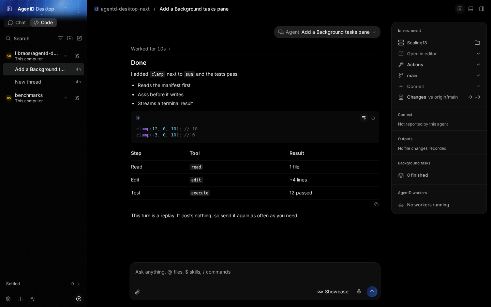

# AgentD Desktop

A desktop, web and phone app for the coding agents that [agentd](https://github.com/libraos/agentd-core) runs and coordinates. agentd is the authority: the app shows its tasks, approvals and workers, and keeps no copy of its own as the truth. It drives the agents already installed and signed in on your machine, such as Claude Code, Codex and opencode. It has no model access of its own and prefers no agent.

It runs on macOS, Linux and Windows.

| First run                                                            | Session panel                                                                                      |
| -------------------------------------------------------------------- | -------------------------------------------------------------------------------------------------- |
|  |  |

## What it does

- **First run:** connect an agent you already use (Claude Code, Codex, opencode), or give every agent models through one LibraOS account with **LibraOS Gateway**. **Use an API key or gateway** lists the endpoints each agent accepts; applying one waits on agentd, so those rows say "Not available yet". **Join a team** enrolls this device with a team's agentd server. When no agent is found yet, **Skip for now** opens the app; Settings → Providers connects one later.
- **Chat and Code:** talk to an agent, or work on a project with its files, changes and branch beside the conversation.
- **Start a task for a worker:** from a session, hand a task to an agentd worker with its goal, acceptance criteria, check and budget.
- **Background tasks:** the tasks agentd runs for this project, running and finished, with live output, and Stop for a running one.
- **AgentD workers:** every worker running now, on this machine, a team node or in the cloud, with its agent, state and time, below Background tasks in the session panel.
- **AgentD page:** agentd's status and checks, what needs you (approvals and messages), and the workers and team nodes.

Features that overlap agentd (scheduled tasks, triage, issues, pull requests, sharing) are hidden; `apps/web/src/productProfile.ts` lists them.

## Download

Installers are on the [releases page](https://github.com/libraos/agentd-desktop-next/releases), with agentd and its Skills inside:

| System                | File                          |
| --------------------- | ----------------------------- |
| macOS (Apple silicon) | `AgentD-Desktop-…-arm64.dmg`  |
| macOS (Intel)         | `AgentD-Desktop-…-x64.dmg`    |
| Windows               | `AgentD-Desktop-…-x64.exe`    |
| Linux                 | `….AppImage` or `…-amd64.deb` |

`SHA256SUMS` lists each file's checksum. The builds are not signed. On macOS, if the app will not open after you move it to Applications, run `xattr -dr com.apple.quarantine "/Applications/AgentD Desktop.app"`. On Windows, SmartScreen asks once: choose **More info**, then **Run anyway**.

The app finds agents on your login shell's `PATH` and in the folders their installers use, such as `~/.local/bin`, `~/.claude/local` and `/opt/homebrew/bin`.

## Run it from source

You need [agentd](https://github.com/libraos/agentd-core) on `PATH` (the installers bring their own), and the agents you want to use installed and signed in.

Install [Vite+](https://viteplus.dev/guide/), which provides the `vp` command and the pinned Node version:

```sh
curl -fsSL https://vite.plus | bash
```

Then, from the repository root:

```sh
vp i
vp run dev
```

Open the pairing URL printed by the dev runner. The [development runbook](./docs/operations/development.md) covers state directories, ports, remote access and desktop builds.

## Build the installers

A release is built by GitHub Actions: push a tag `v<upstream>-agentd.<N>` (for example `v0.1.10-agentd.5`), and `.github/workflows/release.yml` builds the Linux AppImage and `.deb`, the Windows installer and the macOS arm64 and x64 `.dmg`, each with the latest agentd release and its Skills inside, and puts them with a `SHA256SUMS` in a draft release. Review the draft, then publish it. Running the workflow by hand builds the same files as workflow artifacts, without a release.

Locally, `agentd/scripts/build-desktop.sh linux` builds an AppImage and a `.deb`, and `agentd/scripts/build-desktop.sh win` builds a Windows NSIS installer. They build in Docker, so a Linux host builds both. On a Mac, `agentd/scripts/build-desktop.sh mac` builds a `.dmg` for the Mac's architecture. Versions are upstream's version followed by `-agentd.N`, and the builds have no update feed. The builds are not signed: macOS apps are ad-hoc signed and not notarized. [agentd/design/build.md](./agentd/design/build.md) has the details.

## Built on T3 Code

AgentD Desktop is a fork of [T3 Code](https://github.com/pingdotgg/t3code) by T3 Tools Inc., used under the [MIT licence](./LICENSE). `LICENSE` keeps upstream's text and copyright line unchanged. We keep merging upstream; [agentd/UPSTREAM.md](./agentd/UPSTREAM.md) explains how, and `agentd/patches/` lists every change we make to upstream files, one note per task.

## Design

The design and the plan of work are in [libraos/agentd-core#898](https://github.com/libraos/agentd-core/issues/898); the notes for each part are in [agentd/design](./agentd/design). Rules for anyone changing this repository, people or agents, are in [AGENTS.md](./AGENTS.md).

## Licence

[MIT](./LICENSE). Copyright (c) 2026 T3 Tools Inc. for T3 Code.
